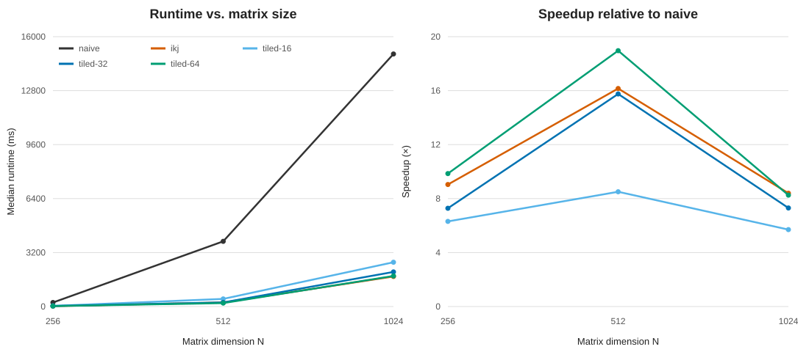

# Cache-Aware Matrix Multiplication

A small C++17 study of how loop order and cache blocking affect single-threaded
dense matrix multiplication on an AMD Ryzen 5 5600H. At 1024×1024, loop
reordering reduced median runtime from **14,972.553 ms to 1,782.846 ms
(8.40×)** and hardware profiling counted **94.4% fewer L1 data-cache load
misses** than the naive loop.



## Design

Matrices use contiguous, row-major `std::vector<float>` storage. The project
preserves three intentionally readable kernels:

- `ijk` (naive): walks each column of B with a large stride.
- `ikj` (reordered): streams rows of B and C contiguously in the inner loop.
- tiled `ikj`: processes square submatrices to increase data reuse.

The candidates 16, 32, and 64 correspond to simplified three-tile working sets
`3 × tile² × sizeof(float)` of 3 KiB, 12 KiB, and 48 KiB. This model motivates
the search around the 32 KiB L1D size, but ignores associativity, cache lines,
other live data, and the kernel's actual access order. Measurement—not the
model—selects the best tile.

## Build and run

```bash
cmake -S . -B build -DCMAKE_BUILD_TYPE=Release
cmake --build build -j
ctest --test-dir build --output-on-failure
./build/matmul_benchmark --size 512 --repetitions 7 --tile 16 --tile 32 --tile 64
python3 scripts/plot.py
```

The build uses C++17, GCC `-O2`, and `-Wall -Wextra -Wpedantic`. CTest runs 846
checks covering known answers, identity and zero matrices, dimensions 1/3/5/8,
partial tiles, zero tile size, dimension/storage errors, and combined absolute
and relative floating-point tolerance. Checks do not depend on `assert`, so
they remain active with `-DNDEBUG`.

## Measured results

These are local measurements from Ubuntu 26.04.1 under WSL2 on an AMD Ryzen 5
5600H. Each entry is the median of seven runs after one warm-up. Inputs,
correctness comparison, checksumming, printing, and CSV output are outside the
timed interval. A kernel call—including result allocation and zero-fill—is
inside it. The primary run was not CPU-pinned.

| N | naive `ijk` | reordered `ikj` | tiled 16 | tiled 32 | tiled 64 | fastest / speedup |
|---:|---:|---:|---:|---:|---:|---:|
| 256 | 237.577 ms | 26.270 ms | 37.656 ms | 32.628 ms | **24.117 ms** | tiled 64 / 9.85× |
| 512 | 3,863.101 ms | 239.071 ms | 454.307 ms | 245.166 ms | **203.734 ms** | tiled 64 / 18.96× |
| 1024 | 14,972.553 ms | **1,782.846 ms** | 2,625.160 ms | 2,050.454 ms | 1,813.421 ms | `ikj` / 8.40× |

Tile 64 was the best blocked configuration at every tested size, despite its
48 KiB simplified working set exceeding L1D. At the largest size, plain `ikj`
was 1.7% faster than tiled 64; cache blocking is not automatically superior.
The full dataset is in [`results/benchmark.csv`](results/benchmark.csv).

## Hardware-counter analysis

`perf stat -r 3` profiled one 1024×1024 kernel per process on logical CPU 0.
All five events were scheduled together without reported multiplexing:

| kernel | cycles | instructions | cache references | cache misses | L1D load misses |
|---|---:|---:|---:|---:|---:|
| naive `ijk` | 20,958,545,686 | 8,652,559,210 | 1,265,939,630 | 451,513,814 | 1,237,177,324 |
| reordered `ikj` | 1,506,952,185 | 8,653,550,648 | 138,702,530 | 1,992,548 | 69,390,284 |
| tiled 64 | 1,557,497,152 | 8,931,264,567 | 204,766,168 | 34,954,535 | 144,562,539 |

Reordering left retired instructions nearly unchanged while reducing measured
L1D load misses by 94.4%, consistent with replacing strided B access with
contiguous row traversal. Generic `cache-misses` is not an L1-specific event.
The tiled generic events varied by up to 82%, so no strong comparative claim is
made from them. Raw outputs and commands are under [`results/perf`](results/perf),
and the verified environment is in
[`results/environment.txt`](results/environment.txt).

## Environment and limitations

- AMD Ryzen 5 5600H: 6 cores/12 threads; 32 KiB L1D and 512 KiB L2 per core;
  16 MiB shared L3; 64-byte cache lines.
- GCC 15.2.0, CMake 4.2.3, perf 7.0.14, Valgrind 3.26.0.
- WSL2 shares the host and virtualizes PMU behavior. `perf` elapsed times differed
  sharply from `steady_clock`, so only the benchmark CSV supplies runtime claims.
- Frequency, host load, scheduler migration, and cold-cache state were not fully
  controlled; results should be rerun before comparing another machine.
- Only square, single-precision, single-threaded matrices were tested; 2048 was
  omitted because the naive seven-run workload was impractical in this session.
- No architecture-specific SIMD, multithreading, packing, or external BLAS is used.
- Floating-point results depend on operation order; tolerance-based comparison is
  appropriate, but this is not a numerical-accuracy study.

## Future work

Useful next steps are packed/transposed B panels, compiler vectorization reports,
explicit SIMD, multithreaded partitioning, Linux-native measurements with CPU
frequency controls, and comparison against an optimized BLAS. GitHub Actions
builds, runs CTest, and performs only a 32×32 smoke benchmark; its remote status
is pending the first pushed workflow run.
